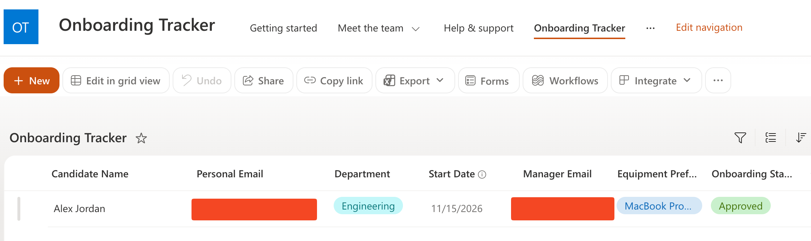
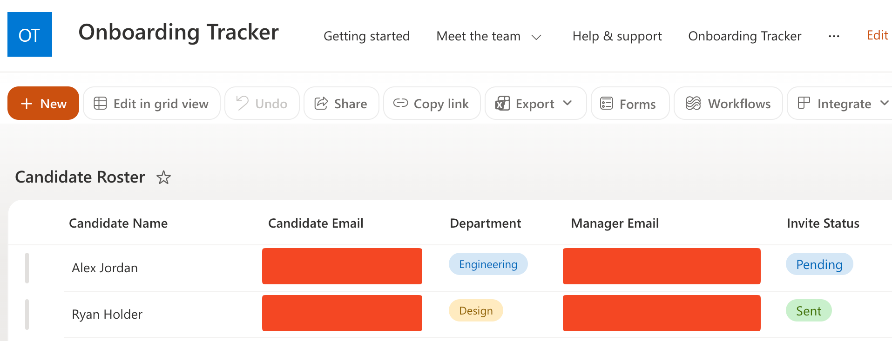
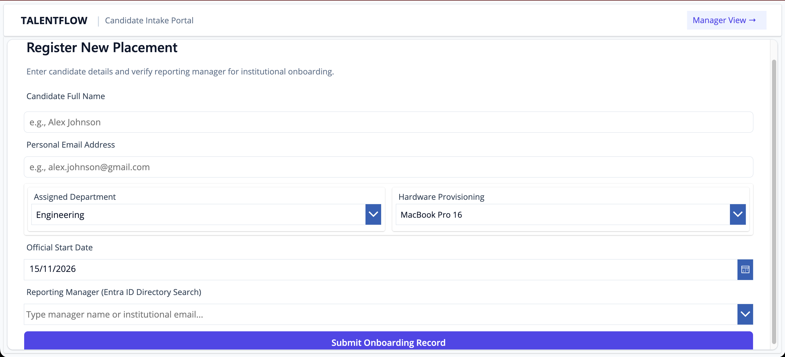
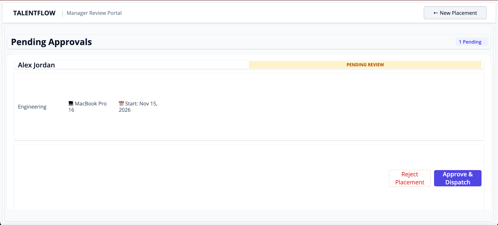
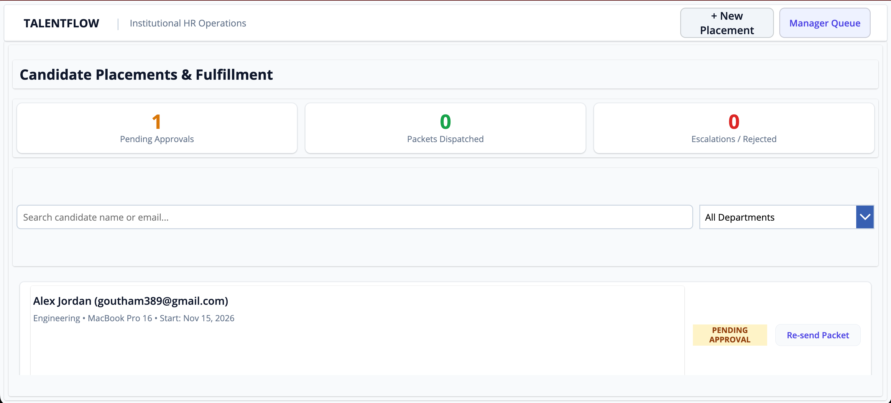
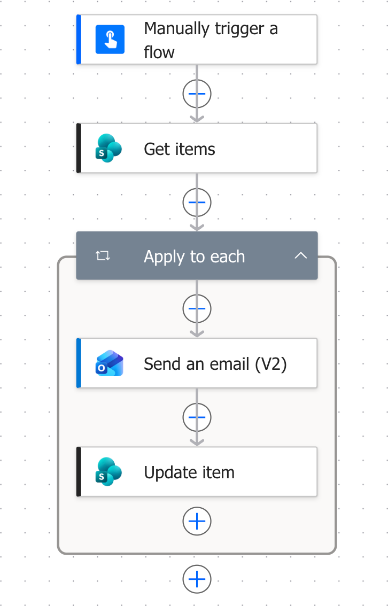
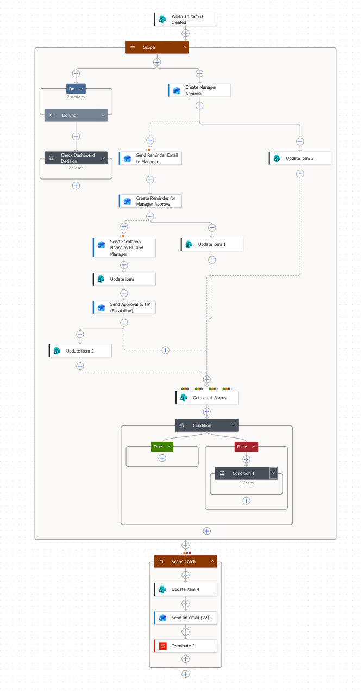
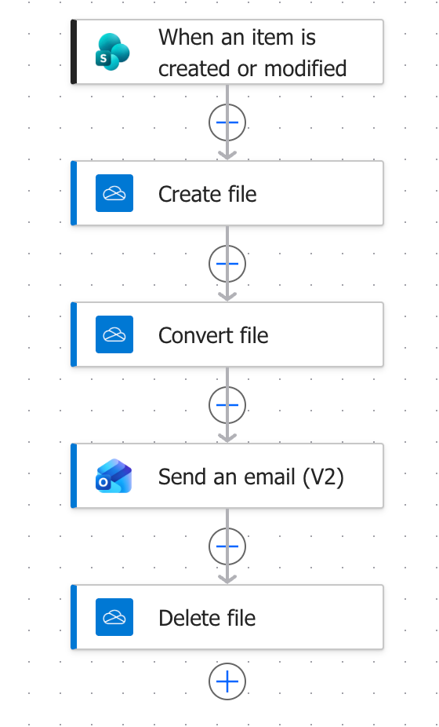

# Enterprise Candidate Onboarding & Lifecycle Engine

[](https://powerapps.microsoft.com/)
[](https://flow.microsoft.com/)
[](https://www.microsoft.com/microsoft-365/sharepoint)
[](#system-architecture)

An end-to-end, multi-stage enterprise candidate intake, approval orchestration, and automated provisioning platform. Built using **Microsoft Power Apps**, **Power Automate**, and **SharePoint Online**, this platform solves parallel webhook race conditions, enforces strict SLA escalations, and incorporates a structured Try-Catch fault tolerance pattern.

---

## Architecture Overview

The system addresses state synchronization across asynchronous human tasks by coordinating email actionable messaging alongside real-time Power Apps dashboard approvals.

```text
                           +-------------------------------------+
                           | 1. Candidate Intake (Power Apps)     |
                           | scr_Intake / SharePoint Create Event |
                           +------------------+------------------+
                                              |
                                              v
                      +-----------------------------------------------+
                      | 2. Orchestrator Engine (Manager Escalator)     |
                      | Scope_Try (Parallel Non-Blocking Architecture) |
                      +-----------------------+-----------------------+
                                              |
                     +------------------------+------------------------+
                     |                                                 |
                     v                                                 v
  +------------------------------------+             +------------------------------------+
  | Path A: Real-Time State Watcher    |             | Path B: Actionable Webhook Chain   |
  | - Do-Until SharePoint Poller       |             | - Manager Approval (48h SLA)       |
  | - Polls status every 60 seconds    |             | - Reminder Escalation (48h SLA)    |
  | - Terminate(Succeeded) on decision |             | - HR Escalation Fallback (48h SLA) |
  +------------------+-----------------+             +------------------+-----------------+
                     |                                                  |
                     +------------------------+-------------------------+
                                              |
                                              v
                              +-------------------------------+
                              | Status Patched to "Approved"  |
                              +---------------+---------------+
                                              |
                                              v
                      +-----------------------------------------------+
                      | 3. Onboarding Fulfillment Engine (Flow 3)     |
                      | - Trigger: Split On with @equals('Approved')  |
                      | - Dynamic HTML Document Compilation           |
                      | - OneDrive Serverless PDF Conversion          |
                      | - Candidate Dispatch & File Lifecycle Cleanup |
                      +-----------------------------------------------+

---

#### Section 2: Visual Artifacts & Screenshots (Updated for 8 Images & Dual Lists)

```markdown
---

## System Visuals & Architecture Artifacts

> **Security & Privacy Note:** All directory identifiers, tenant IDs, and corporate email addresses have been obfuscated in the following architectural artifacts.

### 1. Data Layer & Schema (SharePoint Online)

| Artifact | Source Component | Description |
| :--- | :--- | :--- |
|  | `Onboarding Tracker` List | Primary operational table tracking candidate lifecycle, manager associations, start dates, and approval states (`Approved`, `Rejected`, `Escalated to HR`, `Error / Manual Review Required`). |
|  | `Candidate Roster` List | Upstream staging list storing preliminary candidate imports and dispatch statuses (`Pending`, `Sent`) for batch automation. |

---

### 2. Operations Interface (Power Apps Canvas)

| Portal View | Screen Name | Architectural Role |
| :--- | :--- | :--- |
|  | `scr_Intake` | Validated candidate data entry portal supporting dynamic hardware choice allocation and automated manager verification. |
|  | `scr_ManagerQueue` | Manager-specific authorization queue with role-based filtering (`ManagerEmail.Email = User().Email`) and direct state patching. |
|  | `scr_HRDashboard` | Administrative monitoring console delivering real-time candidate metrics, departmental filtering, and escalation overrides. |

---

### 3. Orchestration & Automation Pipelines (Power Automate)

| Workflow Engine | Definition File | Pipeline Architecture |
| :--- | :--- | :--- |
|  | `flows/01-manual-trigger-definition.json` | High-throughput batch dispatcher processing staged invitations with concurrency throttling (30 repetitions). |
|  | `flows/02-manager-escalator-definition.json` | Core orchestrator combining an active polling watch loop with a multi-tiered 96-hour escalation hierarchy and Try-Catch error recovery. |
|  | `flows/03-onboarding-fulfillment-definition.json` | Trigger-isolated document generator producing dynamic HTML packets, converting via serverless PDF APIs, and executing file cleanup. |

---

## Core System Modules

### 1. High-Throughput Batch Dispatcher (`flows/01-manual-trigger-definition.json`)
* **Staging Ingestion:** Queries the upstream `Candidate Roster` staging list for candidates matching `InviteStatus eq 'Pending'`[cite: 6].
* **Throttled Fan-Out:** Leverages Power Automate `Apply_to_each` with runtime concurrency set to 30 parallel threads, preventing Office 365 Outlook connector rate-limiting[cite: 6].
* **Direct Deep Linking:** Generates customized intake form URLs directly embedded with the tenant ID and application ID to route candidates to the Canvas App[cite: 6].
* **State Transition:** Patches `Candidate Roster` to `Sent` upon successful transmission to prevent redundant outbound dispatch[cite: 6].

### 2. Multi-Stage Approval Orchestrator (`flows/02-manager-escalator-definition.json`)
* **Dual-Channel Polling & Termination:** Resolves native Power Automate parallel execution limits by pairing a `Do-Until` loop with an early-exit `Terminate(Succeeded)` action, immediately killing lingering email webhooks upon dashboard decision[cite: 8].
* **SLA Escalation Sequence:** Enforces a 96-hour escalation hierarchy across Manager Initial Review (48h), Manager Reminder (48h), and HR Takeover (48h)[cite: 8].
* **Enterprise Try-Catch Fault Handling:** Encapsulates core logic in `Scope_Try`[cite: 8]. If any connector fails, execution routes to `Scope_Catch`, patches SharePoint to `Error / Manual Review Required`, and issues an IT incident alert[cite: 8].

### 3. Candidate Intake & Operations Console (`power-apps/src/`)
* **`scr_Intake`**: Self-service onboarding portal featuring client-side input validation, dynamic hardware selection, and direct SharePoint schema patching.
* **`scr_ManagerQueue`**: Filtered operational queue displaying records matching `ManagerEmail.Email = User().Email` with one-click decision controls.
* **`scr_HRDashboard`**: Executive roster and oversight view providing SLA metrics (`Pending`, `Approved`, `Attention Required`), department sorting, and administrative override actions.

### 4. Serverless Document Engine (`flows/03-onboarding-fulfillment-definition.json`)
* **Trigger Isolation:** Filtered via `@equals(triggerBody()?['OnboardingStatus']?['Value'], 'Approved')` to execute strictly on terminal authorization[cite: 7].
* **Transient PDF Generation:** Compiles personalized corporate welcome packets in HTML, converts to PDF via OneDrive API services, dispatches via Outlook, and deletes the transient source file within the same pipeline[cite: 7].

---

## SharePoint Schema Definitions

### List 1: `Onboarding Tracker` (Main Operational Table)

| Column Internal Name | Column Display Name | Type | Notes |
| :--- | :--- | :--- | :--- |
| `Title` | Candidate Name | Single line of text | Required system field[cite: 8] |
| `PersonalEmail` | Personal Email | Single line of text | Recipient personal address[cite: 8] |
| `Department` | Department | Choice | Engineering, HR, Finance, IT, Ops[cite: 8] |
| `StartDate` | Target Start Date | Date and Time | Date only[cite: 8] |
| `EquipmentPreference` | Hardware Choice | Choice | MacBook Pro, ThinkPad, Linux Box[cite: 8] |
| `ManagerEmail` | Reporting Manager | Person or Group | Dynamic manager reference[cite: 8] |
| `OnboardingStatus` | Onboarding Status | Choice | `Pending Approval`, `Approved`, `Rejected`, `Escalated to HR`, `Error / Manual Review Required`[cite: 8] |

---

### List 2: `Candidate Roster` (Staging Table)

| Column Internal Name | Column Display Name | Type | Notes |
| :--- | :--- | :--- | :--- |
| `Title` | Candidate Name | Single line of text | Required system field[cite: 6] |
| `CandidateEmail` | Candidate Email | Single line of text | Target invitation email[cite: 6] |
| `Department` | Department | Single line of text / Choice | Target department[cite: 10] |
| `ManagerEmail` | Manager Email | Single line of text / Person | Assigned reviewer[cite: 10] |
| `InviteStatus` | Invite Status | Choice | `Pending`, `Sent`[cite: 6, 10] |

---

## Deployment & Configuration

1. **SharePoint Setup:**
   * Create both the `Onboarding Tracker` and `Candidate Roster` lists with the column structures defined above[cite: 9, 10].
   * Retrieve each list GUID via `List Settings > Web Address (URL)`.

2. **Power Automate Import:**
   * Import the JSON definition files in `flows/`.
   * Rebind the connection references to your tenant's `Office 365 Outlook`, `SharePoint Online`, and `OneDrive for Business` accounts[cite: 7, 8].
   * In `02-manager-escalator-definition.json`, configure the run-after properties:
     * Set `Scope_Catch` to run after `Scope_Try` has failed, timed out, or been skipped[cite: 8].
     * Ensure the terminating condition verifies `OnboardingStatus/Value` equals `Approved`[cite: 8].

3. **Power Apps Deployment:**
   * Pack the source directory using the Power Platform CLI:
     ```bash
     pac canvas pack --sources "./power-apps/src" --msapp "EnterpriseOnboarding.msapp"
     ```
   * Import the `.msapp` package into your target Power Apps environment and connect the data sources to both SharePoint lists.